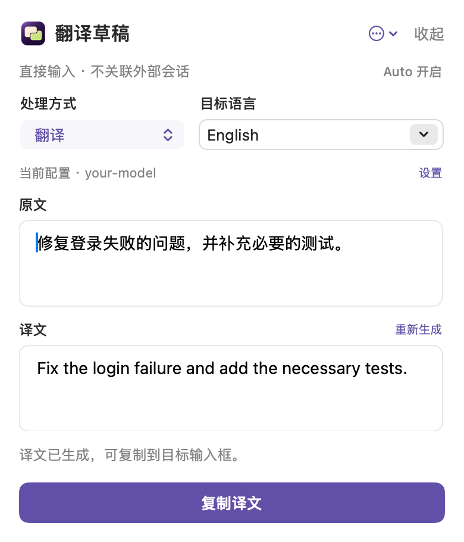

# PromptBridge

在聊天输入框或编程 CLI 中写好草稿，点击浮窗或按 **⌥T**，将整段文字翻译成目标语言，并放回原来的位置。

PromptBridge 是 macOS 上的原生翻译工具，使用你配置的模型 API。支持纯翻译和翻译并优化表达，也可以直接在浮窗中输入文字。

*界面示例使用合成文字与示例模型配置。*

## 下载与开始使用

需要 **macOS 14+、Apple Silicon**。

1. 从 [GitHub Releases](https://github.com/d874284271-commits/PromptBridge/releases) 下载应用 ZIP 并解压。
2. 打开 PromptBridge，在“设置 → 模型连接”填写服务地址、API Key 与模型，点击“保存并使用”。
3. 使用其他应用的输入框时，在“设置 → 翻译与浮窗 → 输入框接入”点击“安装并启用”，再授予辅助功能权限。直接输入不需要此权限。
4. 点击目标输入框，按 **⌥T** 或点击浮窗。

下载版使用自签名证书，**未经 Apple 公证**。首次打开可能被 macOS 拦截，请按照[安装说明](docs/installation.md)在系统设置中允许打开；无需关闭系统安全保护。

## 日常使用

- **Auto 开启（默认）**：一次点击完成读取、翻译和替换。不会发送消息。
- **Auto 关闭**：先预览、编辑译文，再点击“确认替换”。
- **直接输入**：不关联外部输入框，生成后复制译文。
- **恢复原文**：在仍可核对原目标的情况下，恢复最近一次替换。
- **长稿**：原文和译文各自随内容增高，到上限后在各自区域滚动。
- **已有草稿**：更多菜单仅列出实际保存的草稿；草稿与替换记录保留在本次进程内，退出后清空。

CLI 接入在“设置 → CLI 接入”中启用 Claude Code 或 Codex。新开 Terminal 会话后照常启动 CLI；接入不修改模型、插件或通知配置。详细流程与权限说明见[安装与使用](docs/installation.md)。

## 模型连接

支持 OpenAI Chat Completions、Responses 和 Anthropic Messages 格式，可配置兼容服务、自定义 Base URL 与模型。模型服务的费用由所选服务决定；应用不提供内置在线服务或免费额度。

无模型时会引导设置，不生成演示结果。API Key 保存在当前用户的本地配置文件中；发送内容及存储说明见[隐私说明](docs/privacy.md)。

## 支持与反馈

输入框接入取决于当前控件能力、权限及目标一致性；不以宿主精确版本名单拦截。已验证范围和待验证条件见[版本记录](docs/releases/0.9.0.md)，不承诺所有应用输入框均可直接替换。

- [安装与常见问题](docs/installation.md)
- [源码构建与测试](docs/development.md)
- [架构与接入原则](docs/architecture.md)
- [贡献说明](CONTRIBUTING.md) · [安全报告](SECURITY.md) · [变更记录](CHANGELOG.md)
- [首次公开发布计划](docs/plans/2026-11-08-public-release.md)

## 许可

[Apache-2.0](LICENSE)。图标和第三方声明见 [NOTICE](NOTICE)。
